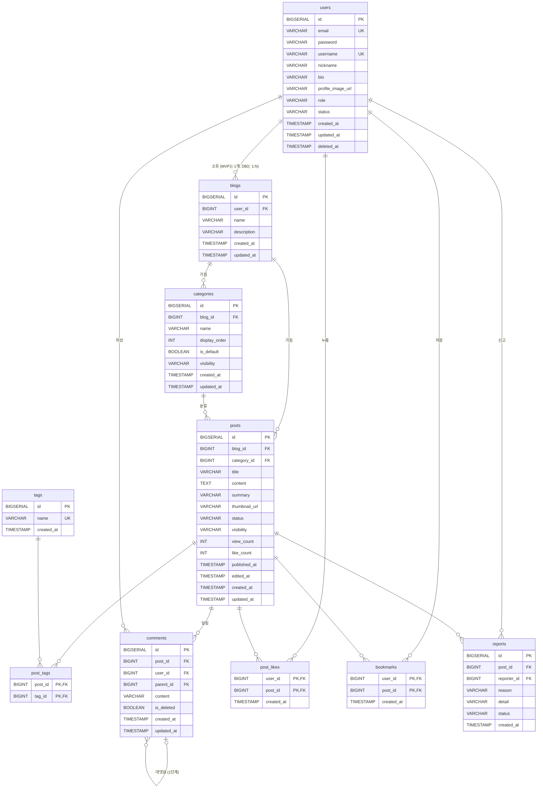

# OwnLog ERD (데이터베이스 설계)

> - 작성일: 2026-10-06
> - 최종 수정: 2026-10-06 (카테고리 공개 범위 추가)
> - 기준 문서: [요구사항.md](../요구사항.md) (8장 2단계 결정 사항)
> - DB: PostgreSQL / ORM: Spring Data JPA

---

## 1. 전체 구조



---

## 2. 공통 규칙

| 항목 | 규칙 |
|---|---|
| PK | `BIGSERIAL` 자동 증가를 써요. 매핑 테이블(`post_tags`, `post_likes`, `bookmarks`)은 복합 PK를 써요 |
| Enum | PostgreSQL ENUM 타입 대신 `VARCHAR(20)`로 저장하고, JPA `@Enumerated(EnumType.STRING)`을 써요 |
| 시간 | `created_at`과 `updated_at`은 JPA Auditing으로 자동으로 채워요 |
| 카운트 컬럼 | `view_count`와 `like_count`는 **엔티티 변경 감지가 아니라 UPDATE 쿼리**(`SET view_count = view_count + 1`)로 바꿔요. 동시 요청에도 값이 유실되지 않고, `updated_at`도 건드리지 않아요 |
| 이름 규칙 | 테이블은 복수형 snake_case, 컬럼은 snake_case로 써요 |

---

## 3. 테이블 정의

### 3.1 `users` (회원)
| 컬럼 | 타입 | NULL | 기본값 | 설명 |
|---|---|---|---|---|
| id | BIGSERIAL | N | | PK |
| email | VARCHAR(255) | N | | **UNIQUE.** 로그인 ID예요. **소문자로 바꿔서 저장**해요. 탈퇴하면 `deleted_{id}@ownlog.invalid`로 익명화해요 (그래서 같은 이메일로 재가입할 수 있어요) |
| password | VARCHAR(255) | N | | BCrypt 해시 |
| username | VARCHAR(20) | N | | **UNIQUE.** 아이디이자 `/@아이디` 주소예요. 영문 소문자, 숫자, `_` 3~20자. 탈퇴해도 해제하지 않아서 **재사용할 수 없어요.** 예약어(`admin`, `ownlog`, `official`, `system` 등)는 쓸 수 없어요 |
| nickname | VARCHAR(20) | N | | 2~20자 |
| bio | VARCHAR(100) | Y | | 한 줄 소개 |
| profile_image_url | VARCHAR(500) | Y | | |
| role | VARCHAR(20) | N | `'USER'` | `USER` / `ADMIN`. 관리자 기능은 2차지만 권한 구조를 미리 준비해 둬요 |
| status | VARCHAR(20) | N | `'ACTIVE'` | `ACTIVE` / `DELETED` |
| created_at | TIMESTAMP | N | | |
| updated_at | TIMESTAMP | N | | |
| deleted_at | TIMESTAMP | Y | | 탈퇴 시각 |

- **JWT 인증 필터는 요청마다 `status = 'ACTIVE'`인지 확인**해요. 탈퇴한 회원이 만료 전 토큰으로 요청하는 걸 막기 위해서예요.
- Spring Security의 `UserDetails.getUsername()`에는 이 테이블의 `username`(아이디)이 아니라 **`email`(로그인 ID)** 을 넘겨요.

### 3.2 `blogs` (블로그) ⭐ 다중 블로그 확장 포인트
| 컬럼 | 타입 | NULL | 기본값 | 설명 |
|---|---|---|---|---|
| id | BIGSERIAL | N | | PK |
| user_id | BIGINT | N | | FK → users. **UNIQUE 제약을 걸지 않아요** (1:N 구조, 요구사항 5.1) |
| name | VARCHAR(50) | N | | 블로그 이름. 가입할 때 기본값은 `{닉네임}의 블로그`예요 |
| description | VARCHAR(200) | Y | | 블로그 소개 (공통 CF-04 "공간의 이름과 소개"에 대응) |
| created_at | TIMESTAMP | N | | |
| updated_at | TIMESTAMP | N | | |

> "1인 1블로그" 제한은 DB가 아니라 **회원가입 서비스 로직**에서 처리해요.

### 3.3 `categories` (카테고리)
| 컬럼 | 타입 | NULL | 기본값 | 설명 |
|---|---|---|---|---|
| id | BIGSERIAL | N | | PK |
| blog_id | BIGINT | N | | FK → blogs |
| name | VARCHAR(30) | N | | `UNIQUE(blog_id, name)` |
| display_order | INT | N | `0` | 사이드바 정렬 순서 (B-04 순서 변경) |
| is_default | BOOLEAN | N | `false` | 기본 카테고리 "미분류"만 `true` |
| visibility | VARCHAR(20) | N | `'PUBLIC'` | `PUBLIC` / `PRIVATE`. 비공개면 그 안의 글은 글 설정과 관계없이 방문자에게 숨겨져요 (B-05, 4.1절) |
| created_at | TIMESTAMP | N | | |
| updated_at | TIMESTAMP | N | | |

- **부분 UNIQUE 인덱스** `UNIQUE(blog_id) WHERE is_default = true`로 블로그마다 기본 카테고리를 1개만 둘 수 있게 해요.
- `is_default = true`인 카테고리는 **삭제할 수 없어요.** 이름, 순서, 공개 범위는 바꿀 수 있어요.
- 블로그당 카테고리는 **최대 30개**예요 (서비스 검증).
- 카테고리의 공개 범위를 바꿔도 `posts.visibility`는 바뀌지 않아요. 그래서 다시 공개로 돌리면 각 글은 원래 설정대로 보여요.

### 3.4 `posts` (글과 임시저장 글)
| 컬럼 | 타입 | NULL | 기본값 | 설명 |
|---|---|---|---|---|
| id | BIGSERIAL | N | | PK |
| blog_id | BIGINT | N | | FK → blogs. 작성자는 `blogs.user_id`로 찾아요 |
| category_id | BIGINT | N | | FK → categories. 고르지 않으면 "미분류"를 넣어요 (임시저장 글도 마찬가지) |
| title | VARCHAR(100) | **Y** | | 임시저장 때문에 NULL을 허용해요. **발행할 때 서비스에서 필수인지 검증해요** |
| content | TEXT | **Y** | | 마크다운 원문. 발행할 때 필수인지 검증해요 |
| summary | VARCHAR(200) | Y | | 카드 목록용 요약. 저장할 때 본문에서 마크다운 문법을 제거하고 앞부분으로 자동으로 만들어요 |
| thumbnail_url | VARCHAR(500) | Y | | |
| status | VARCHAR(20) | N | `'DRAFT'` | `DRAFT` / `PUBLISHED` |
| visibility | VARCHAR(20) | N | `'PUBLIC'` | `PUBLIC` / `PRIVATE`. 글 자체의 설정이에요. 실제 노출 여부는 카테고리의 공개 범위와 함께 판단해요 (4.1절) |
| view_count | INT | N | `0` | 작성자 본인 조회는 제외해요 |
| like_count | INT | N | `0` | 인기순 정렬용 비정규화 컬럼. 좋아요 추가나 취소와 **같은 트랜잭션**에서 바꿔요 |
| published_at | TIMESTAMP | Y | | 처음 발행한 시각. 최신순 정렬과 "최근 7일" 기준이에요 |
| edited_at | TIMESTAMP | Y | | **발행 후 내용을 수정한 시각.** 화면의 "수정일"이에요 (P-05). NULL이면 수정한 적이 없는 글이에요 |
| created_at | TIMESTAMP | N | | |
| updated_at | TIMESTAMP | N | | 임시저장 목록은 이 값의 최신순으로 정렬해요 |

> ⚠️ **`updated_at`을 수정일로 쓰지 않는 이유:** 조회수나 좋아요 수가 바뀔 때 `updated_at`이 갱신될 수 있어요. 그러면 읽기만 한 글도 "수정됨"으로 보이는 버그가 생겨요. 화면의 수정일은 `edited_at`만 써요.

### 3.5 `tags` / `post_tags` (태그, N:M)
| 테이블 | 컬럼 | 타입 | NULL | 설명 |
|---|---|---|---|---|
| tags | id | BIGSERIAL | N | PK |
| tags | name | VARCHAR(20) | N | **UNIQUE.** 앞뒤 공백을 제거하고 저장해요 |
| tags | created_at | TIMESTAMP | N | |
| post_tags | post_id | BIGINT | N | PK, FK → posts |
| post_tags | tag_id | BIGINT | N | PK, FK → tags |

- 글 하나에 태그는 **최대 10개**예요 (서비스 검증).
- 어떤 글에서도 쓰지 않는 태그는 MVP에서 지우지 않고 남겨 둬요.

### 3.6 `comments` (댓글과 대댓글)
| 컬럼 | 타입 | NULL | 기본값 | 설명 |
|---|---|---|---|---|
| id | BIGSERIAL | N | | PK |
| post_id | BIGINT | N | | FK → posts |
| user_id | BIGINT | N | | FK → users. `status = DELETED`인 회원이면 "탈퇴한 사용자"로 표시해요 |
| parent_id | BIGINT | Y | | FK → comments(자기 참조). NULL이면 일반 댓글이에요 |
| content | VARCHAR(1000) | N | | |
| is_deleted | BOOLEAN | N | `false` | 답글이 있는 댓글을 삭제할 때 `true`로 바꾸고 "삭제된 댓글입니다"로 표시해요 |
| created_at | TIMESTAMP | N | | |
| updated_at | TIMESTAMP | N | | |

- **깊이 1단계 규칙:** `parent_id`로 가리키는 댓글은 반드시 `parent_id IS NULL`이어야 해요 (서비스 검증).
- 임시저장 글(`DRAFT`)에는 댓글을 달 수 없어요.

### 3.7 `post_likes` / `bookmarks` (좋아요, 북마크)
| 컬럼 | 타입 | NULL | 설명 |
|---|---|---|---|
| user_id | BIGINT | N | PK, FK → users |
| post_id | BIGINT | N | PK, FK → posts |
| created_at | TIMESTAMP | N | 북마크 목록은 이 값의 최신순으로 정렬해요 |

- 복합 PK `(user_id, post_id)`로 **1인 1회** 규칙을 DB에서 보장해요.

### 3.8 `reports` (신고)
| 컬럼 | 타입 | NULL | 기본값 | 설명 |
|---|---|---|---|---|
| id | BIGSERIAL | N | | PK |
| post_id | BIGINT | N | | FK → posts |
| reporter_id | BIGINT | N | | FK → users |
| reason | VARCHAR(20) | N | | `SPAM` / `ABUSE` / `ADULT` / `ETC` |
| detail | VARCHAR(500) | Y | | `ETC`를 고를 때 적는 상세 사유 |
| status | VARCHAR(20) | N | `'RECEIVED'` | 2차 관리자 처리를 대비한 컬럼이에요 |
| created_at | TIMESTAMP | N | | |

- `UNIQUE(post_id, reporter_id)`로 중복 신고를 막아요 (R-02).

---

## 4. 인덱스

| 테이블 | 인덱스 | 쓰는 곳 |
|---|---|---|
| posts | `(status, visibility, published_at DESC)` | 메인 최신 글, 검색 (S-01, S-05) |
| posts | `(blog_id, status, published_at DESC)` | 블로그 홈 글 목록 (B-03) |
| posts | `(blog_id, category_id, status, published_at DESC)` | 카테고리별 글 목록 (S-07) |
| posts | `(published_at, like_count DESC)` | 인기 글 (S-02) |
| post_tags | `(tag_id)` | 태그 모아보기 (S-06) |
| comments | `(post_id, parent_id, created_at)` | 글 상세의 댓글 목록 |
| blogs | `(user_id)` | 회원의 블로그 찾기 |
| categories | `UNIQUE(blog_id) WHERE is_default = true` | 기본 카테고리를 1개로 보장 |

### 4.1 방문자가 볼 수 있는 글 조건 (공개 조건)

블로그 주인이 아닌 사람에게 글이 보이려면 **아래 조건을 모두 만족**해야 해요.

```sql
p.status = 'PUBLISHED'
AND p.visibility = 'PUBLIC'
AND c.visibility = 'PUBLIC'   -- posts p JOIN categories c ON c.id = p.category_id
```

| 카테고리 | 글 | 방문자 | 주인 |
|---|---|---|---|
| PUBLIC | PUBLIC | 보임 | 보임 |
| PUBLIC | PRIVATE | 숨김 | 보임 (🔒) |
| PRIVATE | PUBLIC | 숨김 | 보임 (🔒) |
| PRIVATE | PRIVATE | 숨김 | 보임 (🔒) |

- **이 조건은 리포지토리 한 곳에 공통으로 정의하고**, 메인, 검색, 태그, 블로그 홈, 카테고리별 목록, 북마크 목록, 글 상세, 사이드바 글 수가 모두 이 조건을 거쳐요. 조회마다 조건을 따로 쓰면 하나만 빠뜨려도 숨긴 글이 노출되기 때문이에요.
- 볼 수 없는 글에 대한 상세 조회, 좋아요, 댓글, 북마크, 신고 요청에는 **404(존재하지 않는 글)** 로 응답해요.
- 3단계 테스트에서 **"비공개 카테고리의 글이 각 목록과 상세에 나오지 않는지"** 를 반드시 검증해요.

> 키워드 검색(S-05)은 MVP에서 `ILIKE '%키워드%'`로 구현해요. 데이터가 많아지면 2차에서 `pg_trgm` 인덱스나 전문 검색(Full-Text Search)으로 바꿔요.

---

## 5. 삭제와 정합성 정책

| 상황 | 처리 |
|---|---|
| **회원 탈퇴** (U-06) | ① 본인 블로그의 글을 모두 Hard Delete해요 (아래 "글 삭제" 규칙이 함께 적용돼요) ② 본인 카테고리와 블로그를 삭제해요 ③ 본인이 누른 좋아요와 북마크를 삭제하고, 그 글의 `like_count`를 줄여요 ④ 다른 사람 글에 단 댓글은 남겨요 ⑤ `users`는 `status = DELETED`로 바꾸고 `deleted_at`을 기록해요 (Soft Delete). **개인정보도 지워요:** `email`은 `deleted_{id}@ownlog.invalid`, `nickname`은 `탈퇴한 사용자`, `password`는 무작위 값의 해시로 바꾸고, `bio`와 `profile_image_url`은 NULL로 바꾸고 프로필 이미지 파일을 삭제해요. `username`은 재사용 방지를 위해 그대로 둬요 |
| **글 삭제** (P-04) | 해당 글의 댓글, 좋아요, 북마크, `post_tags`, **신고 기록까지 함께 삭제**해요 (MVP 한정. 신고 기록 보존은 2차 관리자 기능과 함께 다뤄요) |
| **카테고리 삭제** (B-04) | 그 카테고리의 글을 같은 블로그의 "미분류"로 옮긴 뒤 삭제해요. 기본 카테고리는 삭제할 수 없어요. **삭제하는 카테고리가 비공개면, 옮기는 글의 `visibility`를 모두 `PRIVATE`으로 바꿔서** 숨겨 둔 글이 노출되지 않게 해요 (B-05) |
| **댓글 삭제** (C-01) | 답글이 있으면 `is_deleted = true`로 바꾸고 "삭제된 댓글입니다"로 표시해요. 답글이 없으면 Hard Delete해요 |
| **좋아요 추가·취소** (C-03) | `post_likes`의 INSERT나 DELETE와 `posts.like_count ± 1`을 같은 트랜잭션에서 처리해요 |
| **임시저장 글 발행** (D-05) | `status`를 `DRAFT`에서 `PUBLISHED`로 바꾸고 `published_at`을 기록해요. 필수 항목(제목, 본문, 카테고리)도 검증해요 |
| **발행 글 수정** (P-04) | 제목, 본문, 썸네일, 태그, 카테고리, 공개 범위가 바뀌면 `edited_at`을 갱신해요 |

> FK 삭제 동작은 DB의 `ON DELETE CASCADE`에 기대지 않고 **서비스 계층에서 순서대로 삭제**해요. 삭제 순서와 `like_count` 보정을 코드에서 명확하게 관리하려는 거예요.

---

## 6. 2차 확장 시 고려 사항

| 기능 | ERD 변경 |
|---|---|
| 다중 블로그 | 스키마 변경 없음. `blogs`에 주소용 `slug` 컬럼만 추가해요 |
| 관리자, 신고 처리 | 스키마 변경 없음. `users.role`은 MVP부터 있으니 `ADMIN` 권한을 부여하고, `reports.status`에 처리 상태를 넣어요 |
| 구독, 알림 | `subscriptions`, `notifications` 테이블을 새로 만들어요 |
| 조회수 중복 방지 | `post_views` 테이블 또는 Redis를 써요 |
| 방문자 통계 | `blog_daily_visits` 테이블을 새로 만들어요 |
| Refresh Token | `refresh_tokens` 테이블 또는 Redis를 써요 |
| 이미지 정리 | `uploaded_files` 테이블로 어디에서도 쓰지 않는 이미지를 추적해요 |
