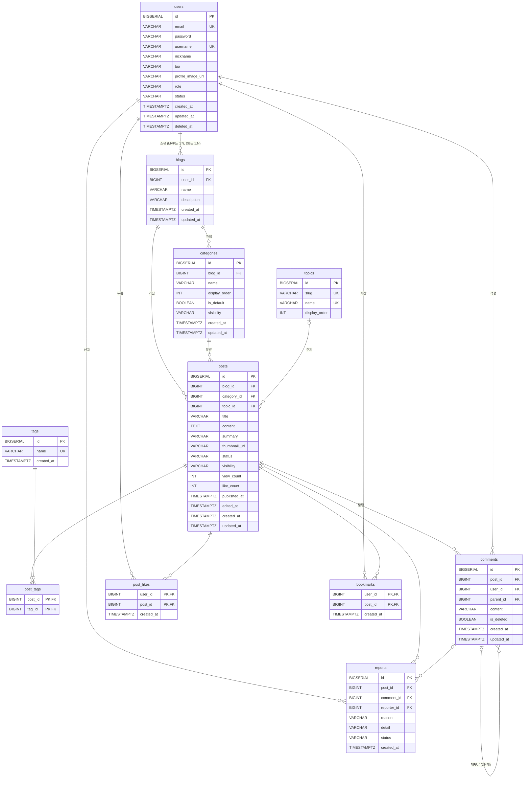

# OwnLog ERD (데이터베이스 설계)

> - 작성일: 2026-10-06
> - 최종 수정: 2026-10-06 (카테고리 공개 범위, 토픽 추가)
> - 기준 문서: [요구사항.md](../요구사항.md) (8장 2단계 결정 사항)
> - DB: PostgreSQL / ORM: Spring Data JPA

---

## 1. 전체 구조



---

## 2. 공통 규칙

| 항목 | 규칙 |
|---|---|
| PK | `BIGSERIAL` 자동 증가를 써요. 매핑 테이블(`post_tags`, `post_likes`, `bookmarks`)은 복합 PK를 써요 |
| Enum | PostgreSQL ENUM 타입 대신 `VARCHAR(20)`로 저장하고, JPA `@Enumerated(EnumType.STRING)`을 써요 |
| 시간 | 모든 시간 컬럼은 **`TIMESTAMPTZ`**(시간대 포함)예요. Java 엔티티는 `Instant`로 받고, API 응답을 만들 때 한국 시간(`+09:00`)으로 바꿔요. 서버나 컨테이너의 시간대가 UTC여도 같은 순간은 같은 값으로 저장돼서 9시간 어긋나는 버그가 없어요. `created_at`과 `updated_at`은 JPA Auditing으로 자동으로 채워요 |
| 카운트 컬럼 | `view_count`와 `like_count`는 **엔티티 변경 감지가 아니라 UPDATE 쿼리**(`SET view_count = view_count + 1`)로 바꿔요. 동시 요청에도 값이 유실되지 않고, `updated_at`도 건드리지 않아요 |
| 이름 규칙 | 테이블은 복수형 snake_case, 컬럼은 snake_case로 써요 |

---

## 3. 테이블 정의

### 3.1 `users` (회원)
| 컬럼 | 타입 | NULL | 기본값 | 설명 |
|---|---|---|---|---|
| id | BIGSERIAL | N | | PK |
| email | VARCHAR(255) | N | | **UNIQUE.** 로그인 ID예요. **소문자로 바꿔서 저장**해요. 탈퇴하면 `deleted_{id}@ownlog.invalid`로 익명화해요 (그래서 같은 이메일로 재가입할 수 있어요) |
| password | VARCHAR(255) | N | | BCrypt 해시 |
| username | VARCHAR(20) | N | | **UNIQUE.** 아이디이자 `/@아이디` 주소예요. 영문 소문자, 숫자, `_` 3~20자. 탈퇴해도 해제하지 않아서 **재사용할 수 없어요.** 예약어(`admin`, `ownlog`, `official`, `system` 등)는 쓸 수 없어요 |
| nickname | VARCHAR(20) | N | | 2~20자 |
| bio | VARCHAR(100) | Y | | 한 줄 소개 |
| profile_image_url | VARCHAR(500) | Y | | |
| role | VARCHAR(20) | N | `'USER'` | `USER` / `ADMIN`. 관리자 기능은 2차지만 권한 구조를 미리 준비해 둬요 |
| status | VARCHAR(20) | N | `'ACTIVE'` | `ACTIVE` / `DELETED` |
| created_at | TIMESTAMPTZ | N | | |
| updated_at | TIMESTAMPTZ | N | | |
| deleted_at | TIMESTAMPTZ | Y | | 탈퇴 시각 |

- **JWT 인증 필터는 요청마다 `status = 'ACTIVE'`인지 확인**해요. 탈퇴한 회원이 만료 전 토큰으로 요청하는 걸 막기 위해서예요.
- Spring Security의 `UserDetails.getUsername()`에는 이 테이블의 `username`(아이디)이 아니라 **`email`(로그인 ID)** 을 넘겨요.

### 3.2 `blogs` (블로그) ⭐ 다중 블로그 확장 포인트
| 컬럼 | 타입 | NULL | 기본값 | 설명 |
|---|---|---|---|---|
| id | BIGSERIAL | N | | PK |
| user_id | BIGINT | N | | FK → users. **UNIQUE 제약을 걸지 않아요** (1:N 구조, 요구사항 5.1) |
| name | VARCHAR(50) | N | | 블로그 이름. 가입할 때 기본값은 `{닉네임}의 블로그`예요 |
| description | VARCHAR(200) | Y | | 블로그 소개 (공통 CF-04 "공간의 이름과 소개"에 대응) |
| created_at | TIMESTAMPTZ | N | | |
| updated_at | TIMESTAMPTZ | N | | |

> "1인 1블로그" 제한은 DB가 아니라 **회원가입 서비스 로직**에서 처리해요.

### 3.3 `categories` (카테고리)
| 컬럼 | 타입 | NULL | 기본값 | 설명 |
|---|---|---|---|---|
| id | BIGSERIAL | N | | PK |
| blog_id | BIGINT | N | | FK → blogs |
| name | VARCHAR(30) | N | | `UNIQUE(blog_id, name)` |
| display_order | INT | N | `0` | 사이드바 정렬 순서 (B-04 순서 변경) |
| is_default | BOOLEAN | N | `false` | 기본 카테고리 "미분류"만 `true` |
| visibility | VARCHAR(20) | N | `'PUBLIC'` | `PUBLIC` / `PRIVATE`. 비공개면 그 안의 글은 글 설정과 관계없이 방문자에게 숨겨져요 (B-05, 4.1절) |
| created_at | TIMESTAMPTZ | N | | |
| updated_at | TIMESTAMPTZ | N | | |

- **부분 UNIQUE 인덱스** `UNIQUE(blog_id) WHERE is_default = true`로 블로그마다 기본 카테고리를 1개만 둘 수 있게 해요.
- `is_default = true`인 카테고리는 **삭제할 수 없어요.** 이름, 순서, 공개 범위는 바꿀 수 있어요.
- 블로그당 카테고리는 **최대 30개**예요 (서비스 검증).
- 카테고리의 공개 범위를 바꿔도 `posts.visibility`는 바뀌지 않아요. 그래서 다시 공개로 돌리면 각 글은 원래 설정대로 보여요.

### 3.4 `posts` (글과 임시저장 글)
| 컬럼 | 타입 | NULL | 기본값 | 설명 |
|---|---|---|---|---|
| id | BIGSERIAL | N | | PK |
| blog_id | BIGINT | N | | FK → blogs. 작성자는 `blogs.user_id`로 찾아요 |
| category_id | BIGINT | N | | FK → categories. 고르지 않으면 "미분류"를 넣어요 (임시저장 글도 마찬가지) |
| topic_id | BIGINT | **Y** | | FK → topics. **NULL이면 "주제 없음"**이에요 (T-02). 바꿔도 `edited_at`은 갱신하지 않아요 |
| title | VARCHAR(100) | **Y** | | 임시저장 때문에 NULL을 허용해요. **발행할 때 서비스에서 필수인지 검증하고, DB의 CHECK 제약으로도 보장해요** |
| content | TEXT | **Y** | | 마크다운 원문 그대로 저장해요(sanitize는 화면에 보여줄 때 해요). 발행할 때 필수이고(CHECK 제약), **최대 100,000자**예요 (서비스 검증) |
| summary | VARCHAR(200) | Y | | 카드 목록용 요약. 저장할 때 본문에서 마크다운 문법을 제거하고 앞부분으로 자동으로 만들어요 |
| thumbnail_url | VARCHAR(500) | Y | | 직접 지정하지 않으면 **저장할 때 본문의 첫 번째 이미지 URL을 자동으로 넣어요.** 본문에도 이미지가 없으면 NULL이에요 |
| status | VARCHAR(20) | N | `'DRAFT'` | `DRAFT` / `PUBLISHED` |
| visibility | VARCHAR(20) | N | `'PUBLIC'` | `PUBLIC` / `PRIVATE`. 글 자체의 설정이에요. 실제 노출 여부는 카테고리의 공개 범위와 함께 판단해요 (4.1절) |
| view_count | INT | N | `0` | 작성자 본인 조회는 제외해요 |
| like_count | INT | N | `0` | 인기순 정렬용 비정규화 컬럼. 좋아요 추가나 취소와 **같은 트랜잭션**에서 바꿔요 |
| published_at | TIMESTAMPTZ | Y | | 처음 발행한 시각. 최신순 정렬과 "최근 7일" 기준이에요 |
| edited_at | TIMESTAMPTZ | Y | | **발행 후 내용을 수정한 시각.** 화면의 "수정일"이에요 (P-05). **제목, 본문, 썸네일, 태그가 바뀔 때만** 갱신해요 (카테고리 이동, 공개 범위 변경은 제외). NULL이면 수정한 적이 없는 글이에요 |
| created_at | TIMESTAMPTZ | N | | |
| updated_at | TIMESTAMPTZ | N | | 임시저장 목록은 이 값의 최신순으로 정렬해요 |

> ⚠️ **`updated_at`을 수정일로 쓰지 않는 이유:** 조회수나 좋아요 수가 바뀔 때 `updated_at`이 갱신될 수 있어요. 그러면 읽기만 한 글도 "수정됨"으로 보이는 버그가 생겨요. 화면의 수정일은 `edited_at`만 써요. 화면의 작성일은 `created_at`이 아니라 `published_at`(처음 발행한 시각)이에요.

**CHECK 제약: 발행 글의 필수 값을 DB에서도 보장해요**
```sql
CONSTRAINT ck_posts_published_required CHECK (
    status = 'DRAFT'
    OR (title IS NOT NULL AND content IS NOT NULL AND published_at IS NOT NULL)
)
```
- 임시저장 글(`DRAFT`)은 제목과 본문이 비어 있어도 돼요.
- 발행 글(`PUBLISHED`)은 제목, 본문, 발행 시각이 **반드시** 있어야 해요. 서비스 코드에 버그가 있어도 DB가 저장을 거부해요.
- 빈 문자열(`''`)은 NULL이 아니라서 이 제약에 걸리지 않아요. 공백만 있는 제목이나 본문은 **서비스 검증**에서 막아요.
- 부분 인덱스처럼 JPA로는 만들 수 없어서 Flyway SQL로 만들어요.
- 발행 글을 임시저장 상태로 되돌리는 기능(발행 취소)은 없어요 (P-04).

### 3.5 `tags` / `post_tags` (태그, N:M)
| 테이블 | 컬럼 | 타입 | NULL | 설명 |
|---|---|---|---|---|
| tags | id | BIGSERIAL | N | PK |
| tags | name | VARCHAR(20) | N | **대소문자 무시 UNIQUE** (`LOWER(name)`). 처음 만들어진 표기 그대로 저장하고 보여줘요. `#`은 빼고, 앞뒤 공백을 제거하고 저장해요 |
| tags | created_at | TIMESTAMPTZ | N | |
| post_tags | post_id | BIGINT | N | PK, FK → posts |
| post_tags | tag_id | BIGINT | N | PK, FK → tags |

- 글 하나에 태그는 **최대 10개**, 태그당 **20자**예요. **한글, 영문, 숫자, `_`, `-`만** 쓸 수 있고 공백은 안 돼요 (서비스 검증). 태그 이름이 URL(`/tags/{태그명}`)에 들어가기 때문이에요.
- `tags`는 블로그나 회원에 속하지 않는 **서비스 전체의 태그 사전**이에요. 내가 쓴 `#Java`와 다른 사람이 쓴 `#Java`는 같은 행이에요.
- 어떤 글에서도 쓰지 않는 태그는 MVP에서 지우지 않고 남겨 둬요.

**대소문자 무시 UNIQUE 인덱스**
```sql
CREATE UNIQUE INDEX uk_tags_name_lower ON tags (LOWER(name));
```
- `Java`가 이미 있으면 `java`나 `JAVA`는 새로 만들지 않고 기존 `Java` 태그를 써요. 조회도 `WHERE LOWER(name) = LOWER(?)`로 해요.
- 일반 `UNIQUE(name)` 대신 이 인덱스를 써요. 함수를 쓰는 인덱스라 JPA로는 만들 수 없어서 Flyway SQL로 만들어요.

**글 저장 시 태그 처리 순서**
1. 앞뒤 공백 제거 → 빈 값 제거 → **대소문자 무시로 중복 제거** (안 하면 `post_tags` PK 위반이 나요)
2. 개수, 길이, 허용 문자 검증
3. 태그 찾기 또는 만들기: `INSERT ... ON CONFLICT DO NOTHING` 후 다시 조회해요 (두 사람이 동시에 같은 새 태그를 만들 때 UNIQUE 위반을 피하려는 거예요)
4. 글 수정 때는 그 글의 `post_tags`를 모두 지우고 새로 넣어요. 태그 구성이 실제로 바뀌었으면 `edited_at`을 갱신해요

**표시 순서:** `post_tags`에는 순서 정보가 없어서, 글 상세에서는 태그를 **이름순**으로 정렬해서 보여줘요.

### 3.6 `comments` (댓글과 대댓글)
| 컬럼 | 타입 | NULL | 기본값 | 설명 |
|---|---|---|---|---|
| id | BIGSERIAL | N | | PK |
| post_id | BIGINT | N | | FK → posts |
| user_id | BIGINT | N | | FK → users. `status = DELETED`인 회원이면 "탈퇴한 사용자"로 표시해요 |
| parent_id | BIGINT | Y | | FK → comments(자기 참조). NULL이면 일반 댓글이에요 |
| content | VARCHAR(1000) | N | | |
| is_deleted | BOOLEAN | N | `false` | 답글이 있는 댓글을 삭제할 때 `true`로 바꾸고 "삭제된 댓글입니다"로 표시해요 |
| created_at | TIMESTAMPTZ | N | | |
| updated_at | TIMESTAMPTZ | N | | |

- **깊이 1단계 규칙:** `parent_id`로 가리키는 댓글은 반드시 `parent_id IS NULL`이어야 하고, **같은 글의 댓글**이어야 해요 (서비스 검증. 다른 행을 봐야 해서 CHECK로는 막을 수 없어요). 화면에서는 답글에 [답글] 버튼을 보여주지 않아요.
- 임시저장 글과 볼 수 없는 글(ERD 4.1)에는 댓글을 달 수 없어요.
- **삭제 권한:** 댓글 작성자 본인, 그리고 **그 글의 블로그 주인**이에요 (C-01). 수정은 작성자 본인만 할 수 있어요.
- **형식:** 일반 텍스트만 저장하고 보여줄 때 escape해요. 마크다운과 HTML은 렌더링하지 않아요.
- **조회:** 글 상세에서 한 번에 모두 불러와요. 일반 댓글은 오래된 순이고, 각 댓글 아래에 답글을 오래된 순으로 붙여요.
  ```sql
  SELECT c.*, u.nickname, u.username, u.status          -- 작성자도 함께 가져와서 N+1을 막아요
    FROM comments c JOIN users u ON u.id = c.user_id
   WHERE c.post_id = ?
   ORDER BY COALESCE(c.parent_id, c.id),   -- 같은 묶음(부모 + 답글)끼리, 묶음은 부모가 쓰인 순서로
            c.parent_id NULLS FIRST,       -- 묶음 안에서 부모가 맨 앞
            c.id                           -- 답글은 쓰인 순서로 (id는 자동 증가라 시각이 같아도 순서가 일정해요)
  ```
  - **정렬은 SQL이 하고, Java는 결과를 위에서부터 한 번 훑으며 "부모면 새 묶음, 답글이면 직전 부모의 `replies`에 추가"만 해요.** 쿼리는 1번이에요.
  - **2차 (댓글 페이지 나누기):** 위 쿼리에 `LIMIT`을 걸면 답글이 다음 페이지로 잘려요. 그때는 **부모 댓글만 `LIMIT`으로 나눠 조회**하고, 그 부모들의 답글은 `WHERE parent_id IN (...)`으로 한 번에 가져와요 (쿼리 2번).
- `updated_at > created_at`이면 화면에 "(수정됨)"을 표시해요.

### 3.7 `post_likes` / `bookmarks` (좋아요, 북마크)
| 컬럼 | 타입 | NULL | 설명 |
|---|---|---|---|
| user_id | BIGINT | N | PK, FK → users |
| post_id | BIGINT | N | PK, FK → posts |
| created_at | TIMESTAMPTZ | N | 북마크 목록은 이 값의 최신순으로 정렬해요 |

- 복합 PK `(user_id, post_id)`로 **1인 1회** 규칙을 DB에서 보장해요.
- 좋아요와 북마크 모두 **자기 글에도 할 수 있어요** (C-03, K-01). 자기 글 좋아요도 `like_count`에 포함돼요.
- 두 테이블 모두 **`(post_id)` 인덱스**를 따로 둬요. PK가 `(user_id, post_id)` 순서라서 `post_id`만으로 찾는 조회(글 삭제 시 함께 삭제)에는 PK를 쓸 수 없기 때문이에요.
- 글이 비공개가 되거나 카테고리가 비공개가 돼도 행은 지우지 않아요. 좋아요 수는 유지되고, 북마크는 목록에서만 빠졌다가 다시 공개되면 돌아와요.

**API는 누르기와 취소를 따로 둬요 (멱등성)**
- 누르기 `PUT`, 취소 `DELETE`예요. 토글 API 하나로 만들면 더블클릭으로 요청이 두 번 갔을 때 눌렀다가 바로 취소돼요.
- **`like_count`는 실제로 행이 바뀌었을 때만** 함께 바꿔요 (같은 트랜잭션).
  ```sql
  -- 누르기: 1줄 들어갔을 때만 +1
  INSERT INTO post_likes (user_id, post_id, created_at) VALUES (?, ?, now())
  ON CONFLICT DO NOTHING;
  -- 취소: 1줄 지워졌을 때만 -1
  DELETE FROM post_likes WHERE user_id = ? AND post_id = ?;
  ```
  이미 누른 상태에서 또 누르기 요청이 오면 아무것도 바뀌지 않고 성공으로 응답해요.

**동시성 규칙 (조회수, 좋아요 수 공통)**
- 숫자는 **Java에서 계산하지 않고 DB가 더하게** 해요 (`SET like_count = like_count + 1`). JPA로 읽고 더해서 저장하면(변경 감지) 동시 요청에서 값이 사라져요 (Lost Update).
- PostgreSQL은 같은 행을 고치려는 요청을 행 잠금으로 줄 세우고, 뒤 요청은 앞 요청이 바꾼 최신 값에 더해요. 그래서 동시에 와도 정확해요.
- **3단계에서 동시성 테스트를 작성해요:** 쓰레드 100개가 서로 다른 사용자로 동시에 좋아요를 누르면 `like_count`가 정확히 100인지 확인해요.

### 3.8 `reports` (신고)
| 컬럼 | 타입 | NULL | 기본값 | 설명 |
|---|---|---|---|---|
| id | BIGSERIAL | N | | PK |
| post_id | BIGINT | **Y** | | FK → posts. **글 신고**일 때 채워요 |
| comment_id | BIGINT | **Y** | | FK → comments. **댓글 신고**일 때 채워요 (R-04) |
| reporter_id | BIGINT | N | | FK → users |
| reason | VARCHAR(20) | N | | `SPAM` / `ABUSE` / `ADULT` / `ETC` |
| detail | VARCHAR(500) | Y | | 상세 사유. **`reason = 'ETC'`이면 필수**예요 (CHECK 제약) |
| status | VARCHAR(20) | N | `'RECEIVED'` | `RECEIVED`(접수) / `RESOLVED`(조치함) / `REJECTED`(문제없음). **MVP는 `RECEIVED`만** 써요. 나머지는 2차 관리자 기능에서 써요 |
| created_at | TIMESTAMPTZ | N | | |

**글 신고와 댓글 신고를 한 테이블에서 관리해요**
```sql
-- 신고 대상은 글 또는 댓글 중 정확히 하나
CONSTRAINT ck_reports_one_target CHECK ((post_id IS NULL) <> (comment_id IS NULL)),
-- "기타" 사유는 상세 사유 필수
CONSTRAINT ck_reports_etc_detail CHECK (reason <> 'ETC' OR detail IS NOT NULL),
-- 중복 신고 방지 (R-02)
CONSTRAINT uk_reports_post    UNIQUE (post_id, reporter_id),
CONSTRAINT uk_reports_comment UNIQUE (comment_id, reporter_id)
```
- **CHECK 제약:** `post_id`와 `comment_id` 중 **딱 하나만** 채워져 있어야 해요. 둘 다 비거나 둘 다 채워지면 DB가 거부해요.
- **UNIQUE 두 개:** PostgreSQL은 UNIQUE에서 NULL끼리는 서로 다른 값으로 봐요. 그래서 댓글 신고 행(`post_id`가 NULL)은 `uk_reports_post`에 걸리지 않고, 글 신고 행은 `uk_reports_comment`에 걸리지 않아요. 각자 자기 대상에 대해서만 중복을 막아요.
- **`ck_reports_etc_detail`:** 같은 행 안의 규칙이라 CHECK로 막아요. 공백만 있는 상세 사유는 서비스 검증에서 막아요.
- **이미 신고한 대상**을 다시 신고하면 UNIQUE 위반이 나기 전에 서비스에서 확인해서 **409**로 응답해요.
- **한 테이블로 둔 이유:** 2차 관리자 화면에서 신고를 **한 목록**으로 처리할 수 있고, 사유와 처리 상태 같은 컬럼을 두 번 만들 필요가 없어요. FK도 그대로 유지돼요.
- 신고할 수 없는 댓글: **자기 댓글**, `is_deleted = true`인 댓글, 볼 수 없는 글(ERD 4.1)의 댓글이에요 (서비스 검증).
- **자기 글과 자기 댓글은 신고할 수 없어요** (R-01, R-04). 글은 `posts.blog_id → blogs.user_id`, 댓글은 `comments.user_id`가 `reporter_id`와 같으면 **400**으로 거부해요.
  - DB로 막지 않는 이유: 확인하려면 `reports → posts → blogs` 세 테이블을 봐야 해서 CHECK 제약으로는 표현할 수 없고, 트리거가 필요해요. 신고가 만들어지는 경로는 신고 API 하나뿐이라 **서비스 한 곳에서 검증하는 것이 명확하고 충분해요.**

### 3.9 `topics` (토픽, 서비스 주제 분류)
| 컬럼 | 타입 | NULL | 기본값 | 설명 |
|---|---|---|---|---|
| id | BIGSERIAL | N | | PK |
| slug | VARCHAR(30) | N | | **UNIQUE.** URL용 영문 이름 (`?topic=travel`). 한 번 정하면 바꾸지 않아요 |
| name | VARCHAR(30) | N | | **UNIQUE.** 화면에 보이는 이름 (예: 여행). 바꿔도 링크는 깨지지 않아요 |
| display_order | INT | N | `0` | 메인 칩 순서 |

- **서비스가 정한 고정 목록**이에요 (T-01). 사용자가 만드는 API는 없고, **Flyway 마이그레이션으로 초기 데이터를 넣고 바꿔요.**
- 다른 테이블을 가리키지 않아요. 블로그나 회원에 속하지 않는 **서비스 전체의 분류**예요 (`tags`와 같은 성격이지만 목록이 고정이에요).
- `posts.topic_id`는 NULL을 허용하고, 토픽 행은 MVP에서 삭제하지 않아요.

**초기 데이터 (11개)**
| slug | name | slug | name |
|---|---|---|---|
| `it` | IT·개발 | `movie` | 영화·드라마 |
| `daily` | 일상 | `music` | 음악 |
| `travel` | 여행 | `book` | 도서 |
| `food` | 요리·맛집 | `pet` | 반려동물 |
| `sports` | 스포츠 | `finance` | 경제·재테크 |
| `game` | 게임 | | |

```sql
INSERT INTO topics (slug, name, display_order) VALUES
 ('it', 'IT·개발', 1), ('daily', '일상', 2), ('travel', '여행', 3),
 ('food', '요리·맛집', 4), ('sports', '스포츠', 5), ('game', '게임', 6),
 ('movie', '영화·드라마', 7), ('music', '음악', 8), ('book', '도서', 9),
 ('pet', '반려동물', 10), ('finance', '경제·재테크', 11);
```

**카테고리, 태그, 토픽 비교**
| | 카테고리 | 태그 | 토픽 |
|---|---|---|---|
| 누가 만드나 | 블로그 주인 | 글쓴이 (자유) | **서비스 (고정)** |
| 범위 | 블로그 안 | 서비스 전체 | 서비스 전체 |
| 글당 개수 | 정확히 1개 | 0~10개 | 0~1개 |
| 주로 쓰는 곳 | 블로그 사이드바 | 태그 모아보기 | 메인 토픽 칩 |

---

## 4. 인덱스

| 테이블 | 인덱스 | 쓰는 곳 |
|---|---|---|
| posts | `(status, visibility, published_at DESC)` | 메인 최신 글, 검색 (S-01, S-05) |
| posts | `(blog_id, status, published_at DESC)` | 블로그 홈 글 목록 (B-03) |
| posts | `(blog_id, category_id, status, published_at DESC)` | 카테고리별 글 목록 (S-07) |
| posts | `(published_at, like_count DESC)` | 인기 글 (S-02) |
| posts | `(topic_id, status, visibility, published_at DESC)` | 메인 토픽 필터 (T-03) |
| post_tags | `(tag_id)` | 태그 모아보기 (S-06) |
| comments | `(post_id, parent_id, created_at)` | 글 상세의 댓글 목록 |
| post_likes | `(post_id)` | 글 삭제 시 좋아요 함께 삭제 |
| bookmarks | `(post_id)` | 글 삭제 시 북마크 함께 삭제 |
| blogs | `(user_id)` | 회원의 블로그 찾기 |
| categories | `UNIQUE(blog_id) WHERE is_default = true` | 기본 카테고리를 1개로 보장 |

### 4.1 방문자가 볼 수 있는 글 조건 (공개 조건)

블로그 주인이 아닌 사람에게 글이 보이려면 **아래 조건을 모두 만족**해야 해요.

```sql
p.status = 'PUBLISHED'
AND p.visibility = 'PUBLIC'
AND c.visibility = 'PUBLIC'   -- posts p JOIN categories c ON c.id = p.category_id
```

| 카테고리 | 글 | 방문자 | 주인 |
|---|---|---|---|
| PUBLIC | PUBLIC | 보임 | 보임 |
| PUBLIC | PRIVATE | 숨김 | 보임 (🔒) |
| PRIVATE | PUBLIC | 숨김 | 보임 (🔒) |
| PRIVATE | PRIVATE | 숨김 | 보임 (🔒) |

- **이 조건은 리포지토리 한 곳에 공통으로 정의하고**, 메인, 검색, 태그, 블로그 홈, 카테고리별 목록, 북마크 목록, 글 상세, 사이드바 글 수가 모두 이 조건을 거쳐요. 조회마다 조건을 따로 쓰면 하나만 빠뜨려도 숨긴 글이 노출되기 때문이에요.
- 볼 수 없는 글에 대한 상세 조회, 좋아요, 댓글, 북마크, 신고 요청에는 **404(존재하지 않는 글)** 로 응답해요.
- 3단계 테스트에서 **"비공개 카테고리의 글이 각 목록과 상세에 나오지 않는지"** 를 반드시 검증해요.

> 키워드 검색(S-05)은 MVP에서 `ILIKE '%키워드%'`로 구현해요. 데이터가 많아지면 2차에서 `pg_trgm` 인덱스나 전문 검색(Full-Text Search)으로 바꿔요.

---

## 5. 삭제와 정합성 정책

| 상황 | 처리 |
|---|---|
| **회원 탈퇴** (U-06) | ① 본인 블로그의 글을 모두 Hard Delete해요 (아래 "글 삭제" 규칙이 함께 적용돼요) ② 본인 카테고리와 블로그를 삭제해요 ③ 본인이 누른 좋아요와 북마크를 삭제하고, 그 글의 `like_count`를 줄여요 ④ 다른 사람 글에 단 댓글은 남겨요 ⑤ `users`는 `status = DELETED`로 바꾸고 `deleted_at`을 기록해요 (Soft Delete). **개인정보도 지워요:** `email`은 `deleted_{id}@ownlog.invalid`, `nickname`은 `탈퇴한 사용자`, `password`는 무작위 값의 해시로 바꾸고, `bio`와 `profile_image_url`은 NULL로 바꾸고 프로필 이미지 파일을 삭제해요. `username`은 재사용 방지를 위해 그대로 둬요 |
| **글 삭제** (P-04) | 해당 글의 댓글(그 댓글들에 대한 신고 포함), 좋아요, 북마크, `post_tags`, **글 신고 기록까지 함께 삭제**해요 (MVP 한정. 신고 기록 보존은 2차 관리자 기능과 함께 다뤄요) |
| **카테고리 삭제** (B-04) | 그 카테고리의 글을 같은 블로그의 "미분류"로 옮긴 뒤 삭제해요. 기본 카테고리는 삭제할 수 없어요. **삭제하는 카테고리가 비공개면, 옮기는 글의 `visibility`를 모두 `PRIVATE`으로 바꿔서** 숨겨 둔 글이 노출되지 않게 해요 (B-05) |
| **댓글 삭제** (C-01) | 댓글 작성자 또는 그 글의 블로그 주인이 삭제할 수 있어요. 답글이 있으면 `is_deleted = true`로 바꾸고 "삭제된 댓글입니다"로 표시해요 (행이 남으니 그 댓글의 신고 기록도 남아요). 답글이 없으면 그 댓글의 신고 기록과 함께 Hard Delete해요. **답글을 지운 뒤 부모가 `is_deleted = true`이고 남은 답글이 없으면 부모도 함께 Hard Delete해요** |
| **좋아요 추가·취소** (C-03) | `post_likes`의 INSERT나 DELETE와 `posts.like_count ± 1`을 같은 트랜잭션에서 처리해요 |
| **임시저장 글 발행** (D-05) | `status`를 `DRAFT`에서 `PUBLISHED`로 바꾸고 `published_at`을 기록해요. 필수 항목(제목, 본문, 카테고리)도 검증해요 |
| **발행 글 수정** (P-04) | **제목, 본문, 썸네일, 태그**가 바뀌면 `edited_at`을 갱신해요. 카테고리 이동과 공개 범위 변경은 내용 수정이 아니라서 갱신하지 않아요 |

> FK 삭제 동작은 DB의 `ON DELETE CASCADE`에 기대지 않고 **서비스 계층에서 순서대로 삭제**해요. 삭제 순서와 `like_count` 보정을 코드에서 명확하게 관리하려는 거예요.

---

## 6. 2차 확장 시 고려 사항

| 기능 | ERD 변경 |
|---|---|
| 다중 블로그 | 기존 테이블 구조와 데이터는 그대로예요. `blogs`에 주소용 `slug` 컬럼(NULL 허용)만 추가하고, 글과 카테고리의 FK는 이미 `blog_id`라서 옮길 필요가 없어요 |
| 토픽 관리 | 스키마 변경 없음. 관리자 화면에서 `topics` 행을 추가하거나 이름을 바꿔요 (지금은 Flyway로 관리) |
| 관리자, 신고 처리 | 스키마 변경 없음. `users.role`은 MVP부터 있으니 `ADMIN` 권한을 부여하고, `reports.status`를 `RESOLVED`/`REJECTED`로 바꿔요. 신고 시점 내용 보존이 필요하면 `reports`에 스냅샷 컬럼을 추가하고, 신고된 글의 삭제 정책(Soft Delete 등)도 함께 정해요 |
| 구독, 알림 | `subscriptions`, `notifications` 테이블을 새로 만들어요 |
| 조회수 중복 방지 | `post_views` 테이블 또는 Redis를 써요 |
| 방문자 통계 (팀 DB의 `blog_daily_stat`, `UNIQUE(blog_id, stat_date)` 참고) | 일별 통계 테이블을 새로 만들어요. **증가는 UPSERT**(`INSERT ... ON CONFLICT (blog_id, stat_date) DO UPDATE SET views = views + 1`)로 해서 동시 요청에도 정확하게 세요. 같은 행에 요청이 몰리면 **Redis `INCR`로 모았다가 주기적으로 DB에 반영**해요 (읽기와 초기화는 `GETDEL`처럼 한 명령으로, 서버가 여러 대면 반영 작업에 분산 잠금). **방문자 수는 중복 제거**가 필요해요 (Redis Set/HyperLogLog 또는 방문 기록 테이블의 UNIQUE). **날짜는 한국 시간(`Asia/Seoul`) 기준**으로 계산해요 (UTC로 계산하면 오전 0~9시 방문이 전날로 잡혀요) |
| Refresh Token | `refresh_tokens` 테이블 또는 Redis를 써요 |
| 이미지 정리 (팀 DB의 `post_image(post_id, storage_key)` 참고) | `uploaded_files` 테이블로 어디에서도 쓰지 않는 이미지를 추적해요 |
